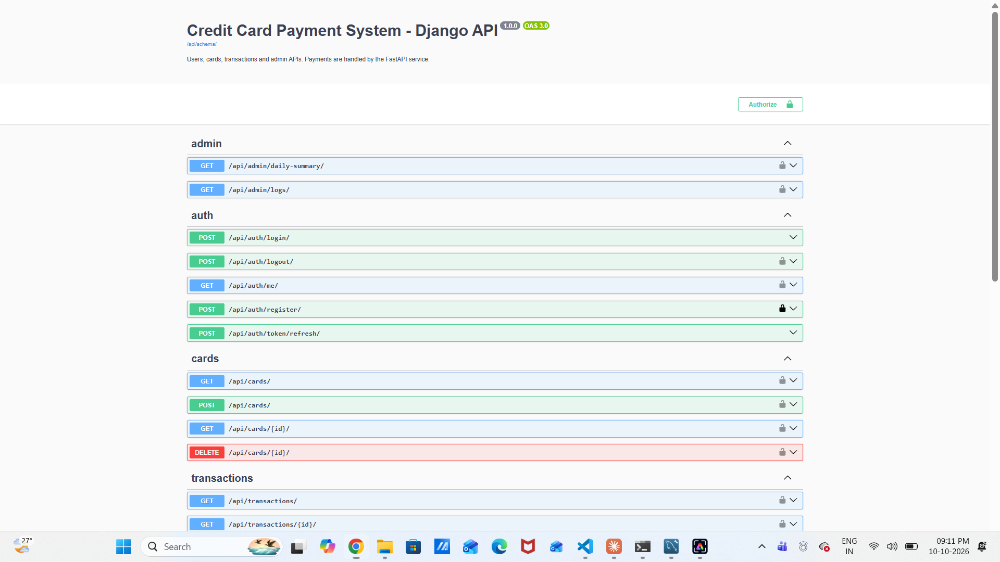
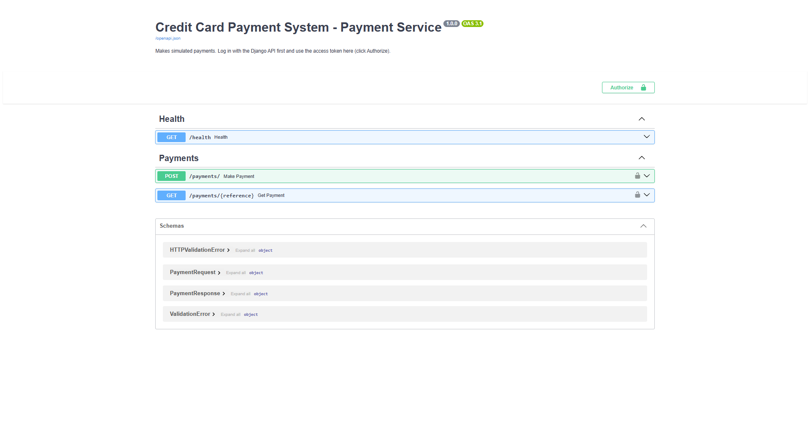
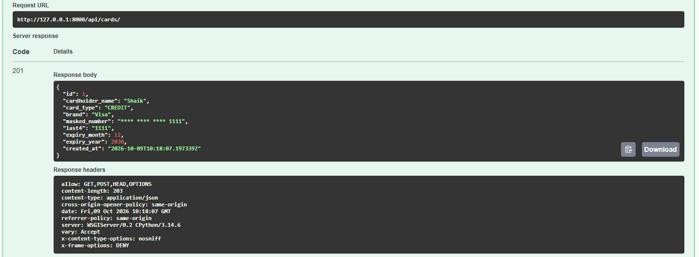
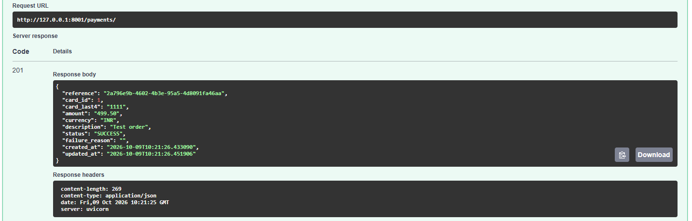
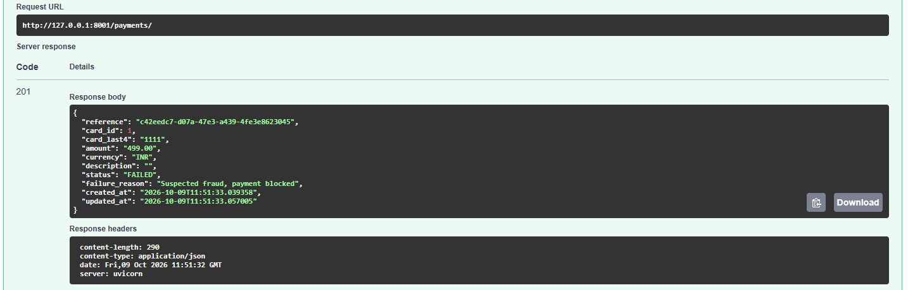
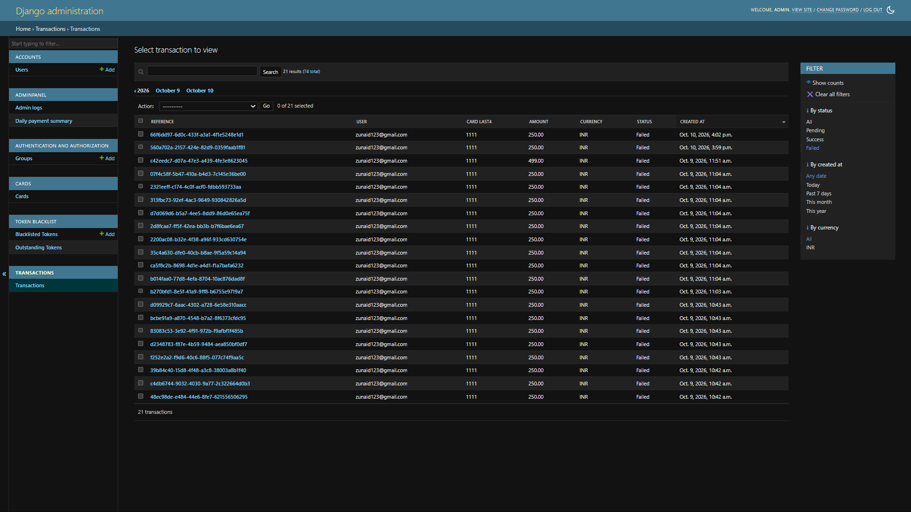
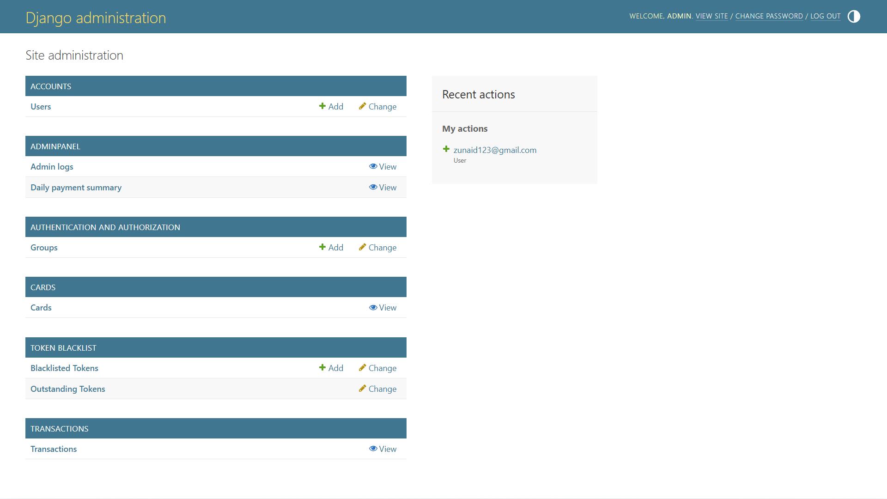
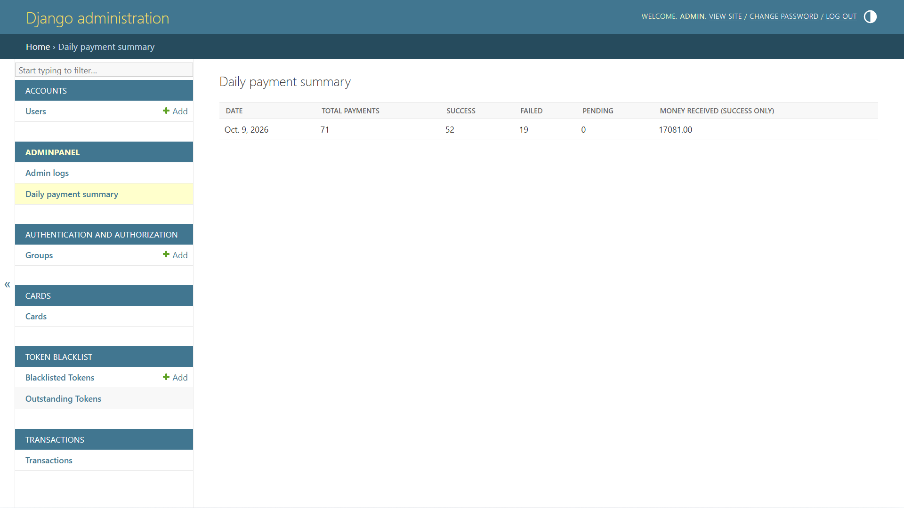
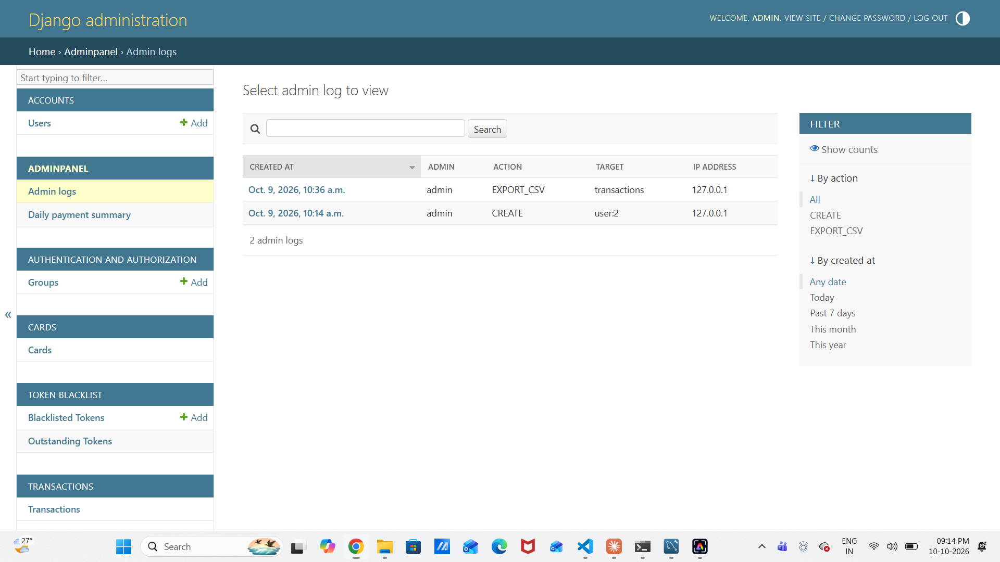
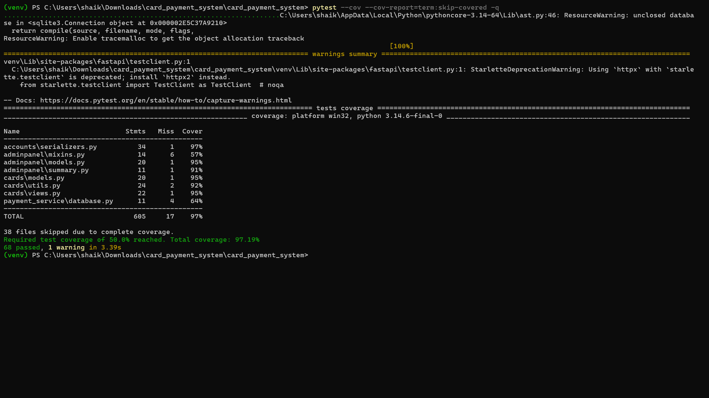

# Credit Card Payment System

A backend for saving cards and making simulated payments.

- **Django + Django REST Framework** (port 8000): users, JWT login, cards, transaction history, admin panel
- **FastAPI** (port 8001): payment processing (PENDING -> SUCCESS / FAILED)
- **MySQL**: one database shared by both services

How the two services work together: the user logs in on Django and gets a JWT.
The same token is then sent to FastAPI to make a payment. Both services use the same
`JWT_SECRET_KEY`, so FastAPI can check the token without calling Django.

---

## Folder structure

```
card_payment_system/
├── manage.py
├── requirements.txt
├── .env.example            <- copy to .env
├── schema.sql              <- database schema (reference)
├── postman_collection.json
├── pytest.ini / .coveragerc
├── config/                 <- Django project (settings, urls)
├── accounts/               <- register, login, logout, profile (users table)
├── cards/                  <- add / view / delete cards (cards table)
├── transactions/           <- history, filters, CSV export (transactions table)
├── adminpanel/             <- admin logs, daily summary (admin_logs table)
├── payment_service/        <- FastAPI app (payments)
├── tests/                  <- all tests
└── docs/screenshots/
```

---

## Setup (step by step)

**1. Requirements:** Python 3.10+, MySQL 8, Git.

**2. Create a virtual environment and install packages**

```bash
python -m venv venv
venv\Scripts\activate          # Windows
source venv/bin/activate       # Mac / Linux
pip install -r requirements.txt
```

**3. Create the MySQL database**

```sql
CREATE DATABASE card_payment_db CHARACTER SET utf8mb4;
```

**4. Create your `.env` file**

```bash
copy .env.example .env         # Windows
cp .env.example .env           # Mac / Linux
```

Open `.env` and put your real MySQL password in `DB_PASSWORD`.

**5. Create the tables and an admin user**

```bash
python manage.py migrate
python manage.py createsuperuser
```

**6. Run both servers (two terminals, venv activated in both)**

```bash
# terminal 1 - Django
python manage.py runserver 8000

# terminal 2 - FastAPI
uvicorn payment_service.main:app --port 8001 --reload
```

---

## API documentation

| What                      | URL                                  |
|---------------------------|--------------------------------------|
| Django Swagger UI         | http://127.0.0.1:8000/api/docs/      |
| Django ReDoc              | http://127.0.0.1:8000/api/redoc/     |
| Django OpenAPI schema     | http://127.0.0.1:8000/api/schema/    |
| FastAPI Swagger UI        | http://127.0.0.1:8001/docs           |
| Django admin panel        | http://127.0.0.1:8000/admin/         |
| Postman collection        | `postman_collection.json`            |

In Swagger, log in first, copy the `access` token, click **Authorize** and paste it.

### Django endpoints (port 8000)

| Method | URL                              | Who        | What                           |
|--------|----------------------------------|------------|--------------------------------|
| POST   | `/api/auth/register/`            | anyone     | Register                       |
| POST   | `/api/auth/login/`               | anyone     | Login, returns access + refresh|
| POST   | `/api/auth/token/refresh/`       | anyone     | New access token               |
| POST   | `/api/auth/logout/`              | logged in  | Blacklist the refresh token    |
| GET    | `/api/auth/me/`                  | logged in  | My profile (protected route)   |
| POST   | `/api/cards/`                    | logged in  | Add card                       |
| GET    | `/api/cards/`                    | logged in  | View my saved cards            |
| DELETE | `/api/cards/<id>/`               | logged in  | Delete my card                 |
| GET    | `/api/transactions/`             | logged in  | My history (filters below)     |
| GET    | `/api/transactions/<id>/`        | logged in  | One transaction                |
| GET    | `/api/transactions/export/`      | admin      | Download CSV                   |
| GET    | `/api/admin/daily-summary/`      | admin      | Daily payment summary          |
| GET    | `/api/admin/logs/`               | admin      | Admin log entries              |

**Transaction filters:** `?status=SUCCESS`, `?min_amount=100&max_amount=1000`,
`?date_from=2026-10-01&date_to=2026-10-31`, and `?ordering=-amount`. They can be combined.
The CSV export accepts the same filters.

### FastAPI endpoints (port 8001)

| Method | URL                       | What                                   |
|--------|---------------------------|----------------------------------------|
| POST   | `/payments/`              | Make a payment (needs Bearer token)    |
| GET    | `/payments/{reference}`   | Get one of my payments                 |
| GET    | `/health`                 | Health check                           |

Example request body for `POST /payments/`:

```json
{ "card_id": 1, "amount": "499.50", "currency": "INR", "description": "Test order" }
```

The payment is saved as `PENDING`, the bank is simulated, and then it is updated to
`SUCCESS` or `FAILED` (with a `failure_reason`). Chance of success is `PAYMENT_SUCCESS_RATE` in `.env`.

---

## Admin panel

Log in at `/admin/` with the superuser. It has:

- **Users**: add, edit, deactivate
- **Cards**: view and delete (read only, the full number never existed in the database)
- **Transactions**: view, filter, search, and *Export selected to CSV* action
- **Daily payment summary**: payments, successes, failures and money received per day
- **Admin logs**: record of admin edits, deletes and CSV exports

---

## Database schema

Full SQL is in `schema.sql`. Django creates the tables with `migrate`.

```
users            cards                  transactions               admin_logs
-----            -----                  ------------               ----------
id (PK)          id (PK)                id (PK)                    id (PK)
username (UQ)    user_id (FK users)     reference (UQ)             admin_id (FK users)
email (UQ)       cardholder_name        user_id (FK users)         action
password (hash)  card_type              card_id (FK cards, null)   target
first_name       brand                  card_last4                 details
last_name        masked_number          amount                     ip_address
phone            last4                  currency                   created_at
is_staff         expiry_month           description
is_active        expiry_year            status (PENDING/SUCCESS/FAILED)
date_joined      created_at             failure_reason
                                        created_at, updated_at
```

Relations: one user has many cards, one user has many transactions, one card has
many transactions, one admin has many log entries.
(Django also creates its own helper tables such as `django_migrations` and the JWT blacklist tables.)

To make a database dump for submission:

```bash
mysqldump -u root -p card_payment_db > card_payment_db_dump.sql
```

---

## Security

| Rule                    | How it is done                                                            |
|-------------------------|---------------------------------------------------------------------------|
| No CVV storage          | CVV is checked (3-4 digits) and then thrown away. There is no CVV column. |
| No full card numbers    | Only `masked_number` (`**** **** **** 1111`) and `last4` are saved        |
| Encrypted passwords     | Django PBKDF2-SHA256 hashing + password strength rules                    |
| JWT authentication      | Short lived access token (30 min), refresh token (1 day), logout blacklists the refresh token |
| Protected routes        | Every DRF view requires login by default; admin views need `is_staff`     |
| Input validation        | DRF serializers (Luhn check, expiry, CVV, name, phone) and Pydantic in FastAPI |
| SQL injection           | Only the Django ORM and SQLAlchemy ORM are used, no raw SQL strings       |
| Data isolation          | Users can only see / delete their own cards and transactions              |
| CSV injection           | Cells starting with `=`, `+`, `-`, `@` are escaped in the CSV export      |
| Secrets                 | Kept in `.env`, which is in `.gitignore`                                  |

---

## Running the tests

The tests use an in-memory SQLite database, so MySQL does not have to be running.

```bash
pytest                          # run all tests
pytest --cov                    # with coverage report (needs at least 50%)
pytest --cov --cov-report=html  # opens-able report in htmlcov/index.html
```

Test files: `tests/test_auth.py`, `tests/test_cards.py`, `tests/test_payments.py`,
`tests/test_transactions.py`, `tests/test_admin_panel.py`.

---

## Screenshots

Put your screenshots in `docs/screenshots/` (the list of what to capture is in
`docs/screenshots/README.md`) and then they show here:












---

## Common problems

- **`Access denied for user`**: wrong `DB_USER` / `DB_PASSWORD` in `.env`.
- **`Unknown database 'card_payment_db'`**: create the database first (step 3).
- **FastAPI says `Invalid or expired token`**: the token is older than 30 minutes, or
  `JWT_SECRET_KEY` is different in the two services. It must come from the same `.env`.
- **FastAPI says `Card not found`**: the card belongs to a different user, or `card_id` is wrong.
